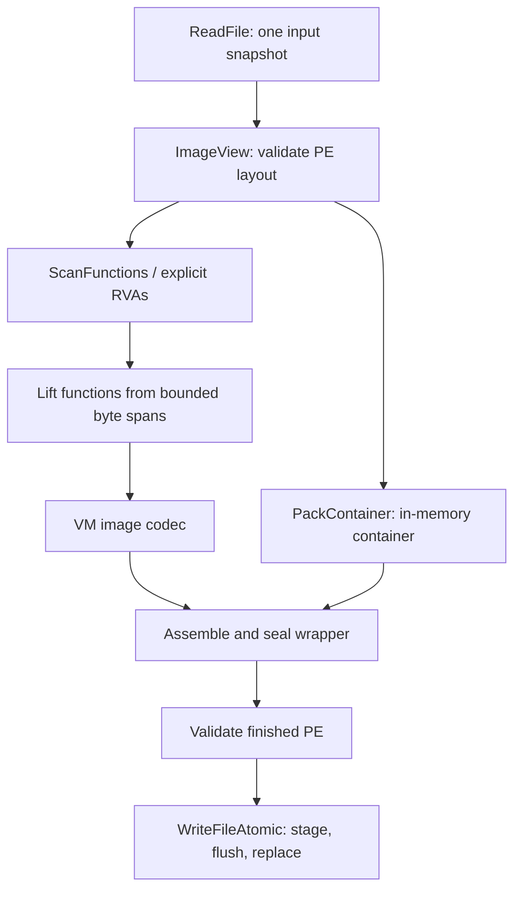

# PE protection build architecture

The protection pipeline now shares a validated PE file view and one input
snapshot. PE structure checks, file I/O and container construction have
separate interfaces; batch lifting no longer reads or copies the remaining
executable for each function.



## Module boundaries

| Module | Responsibility | Callers |
| --- | --- | --- |
| `Src/Libs/Pe/PeImage.*` | Decode PE32/PE32+ metadata, validate layout, resolve bounded file/RVA ranges | Container, build log, lifter, CLI, stub |
| `Src/Libs/Pe/PeLayout.*` | Plan appended sections with checked lengths, offsets and alignments before mutation | CLI, regression tests |
| `Src/Libs/Pe/PeRelocations.*` | Validate x64 relocation blocks and snapshot non-overlapping target RVAs | CLI preflight, stub, regression tests |
| `Src/Libs/Pe/WindowsResources.h` | Own complete virtual-memory reservations across normal and exceptional exits | Stub, regression tests |
| `Src/Libs/Pe/FileIo.*` | Read bytes and commit output files; Windows I/O is isolated here | Container commands, lifter path adapters, CLI |
| `Src/Libs/Lifter/X64Lifter.*` | Discover executable candidates and decode bounded code into IR | CLI and regression tests |
| `Src/Libs/Container/PeVmContainer.*` | Build/decode the existing v5 container; command functions adapt paths and logging | CLI and stub |
| `Src/Libs/Container/VmImageCodec.*` | Existing authenticated VM image format | Lifter and stub |
| `Src/Apps/Cli/PeVmMain.cpp` | Select stages, preserve the input snapshot, assemble and commit output | CLI and GUI subprocess |

`ImageView` uses standard C++ types and reads integers by value. It does not
depend on Windows headers, the VM or the container. `ParsePe()` remains a
compatibility facade over this parser. The build log consumes the same
decoded section records instead of maintaining its own offset arithmetic.
The common static-library project continues to aggregate these modules.

## Input and lifetime contract

`ImageView` borrows a `span<const uint8_t>`; the owner must keep the bytes
alive and unchanged. It stores decoded headers and section records by value.
It is a **file-layout** view, not a view of an already mapped image.

The CLI owns the input vector through inspection, candidate discovery,
lifting and container construction. Changes to the source file after that
read cannot make the lifting stage and packaging stage consume different
bytes. This does not promise an atomic filesystem snapshot while the initial
read itself is in progress.

The path-based lifting APIs remain available. A batch path API reads once,
then delegates to the `ImageView` overload. The raw-code API retains its
vector interface; the internal decoder consumes a bounded span. No
per-function copy from the entry offset to EOF is made.

For an input of S bytes and F functions, batch input reads and file-sized
copies previously scaled with F*S. They now require one input read and no
file-sized copy per function; actual decoding still scales with the code
examined. This is a structural cost reduction, not an end-to-end speedup
measurement. The input snapshot remains resident through the build, and
container/encryption/output buffers still consume additional memory.

## Validation and candidate policy

The shared parser checks DOS/NT bounds, machine/magic consistency, optional
header size, directory count, section table bounds, alignment, image/header
sizes, raw/virtual extents, and section overlap. Range checks subtract from
the limit before comparing sizes, avoiding overflow in offset-plus-size
checks. The mapped extent includes both `VirtualSize` and `SizeOfRawData`.

`FileBytesAtRva()` requires the entire range to belong to one file-backed
region. Zero-filled tails and RVA gaps do not alias later file bytes.
`CodeAtRva()` additionally requires an executable section and caps the view
at its raw end. Pending decoder branches are bounded on both sides of the
function's input window. Export strings must terminate inside their
file-backed region.

Directory access honors both `SizeOfOptionalHeader` and
`NumberOfRvaAndSizes`. The certificate directory is interpreted as a file
offset, not an RVA. General directory checks validate outer extents; export
and exception-table scanning also validates the nested tables it consumes.
Relocation preflight also validates complete blocks and targets. This is not
a complete validator for every import, TLS or other directory's internal
structure; those loader paths still need separate auditing.

Discovery rejects partial exception records and out-of-bounds export
ordinals/arrays. Export forwarders and data exports are excluded from
function candidates. Per-function decode failures still appear in the
tolerant batch result. A malformed shared PE/table fails the operation
instead of being retried independently for every function.

PE32 and native-subsystem images remain supported by the container flow.
Runnable wrappers require x64 PE32+ GUI/CUI inputs and a full PE32+ optional
header, matching the stub's existing header access. The stub performs shared
layout validation before allocation/copy and treats undeclared directories
as absent. The same parser validates the stub template and completed wrapper.

This is intentionally stricter than the previous header-only acceptance:
overlapping, truncated or nonconforming layouts can now fail earlier. It is
not a promise to accept every unusual image the Windows loader might accept.

## Checked layout and runtime ownership

`PlanAppendSections()` returns only value metadata, so the borrowed source
view is destroyed before vector mutation. It checks section count, header
capacity and unused header bytes, then calculates raw extents, virtual
extents and initialized-data size with checked 64-bit intermediates. Inputs
larger than the PE's 32-bit fields are rejected before allocation or narrowing.
New sections start after `SizeOfImage`, not after whichever section happens
to be last in the table. Raw padding contributes to mapped extents;
low-alignment plans preserve identical raw offsets and RVAs. Existing overlay
bytes remain in place. The CLI writes payload, metadata and optional VM data
in matching raw/virtual order and updates `SizeOfInitializedData`.

Signed stub templates are rejected instead of retaining invalid certificate
metadata. This does not add Authenticode signing support: the current wrapper
requires its own footer at EOF, so appending a certificate to a completed
wrapper is not supported by this format.

`RelocationTargets()` validates the serialized x64 table before mapping. It
rejects truncated/odd-sized blocks, unsupported types, unmapped or crossing
8-byte targets, header writes and overlapping fixups. Valid DIR64 targets in
zero-filled section tails remain supported, and ABSOLUTE padding is ignored.
The CLI uses the same preflight, so a malformed relocation table fails before
an output is committed. The stub applies a captured target list with `memcpy`
for unaligned pointers and unsigned modulo arithmetic for relocation deltas;
fixups cannot change the records still being traversed.

Mapped-image and thunk reservations have noncopyable RAII owners. They are
released even if image construction throws; on normal destruction, unwind
tables are deregistered before the owned image is freed. This change covers
these reservations, not every resource acquired by dependency loading or TLS
initialization. The runtime's existing process-entry/TLS limitations remain.

## Container and output stages

`PackContainer(Plain, Password, Compress, Progress)` returns container bytes.
It does not read/write paths or emit a completion event. `CmdPack()` owns
file I/O, while wrap/protect commands pass the returned buffer directly to
the wrapper assembler. They no longer create, overwrite or remove
`<output>.payload.tmp`.

`WriteFileAtomic()` exclusively creates a unique sibling staging file,
writes in bounded chunks, flushes and closes it, then replaces the destination
using `MoveFileExW`. It never deletes the existing destination before commit.
Failures clean up the owned staging file; existing output survives a failed
replacement. This contract was exercised on the local Windows filesystem;
it does not add a filesystem-independent power-loss or network-share
durability guarantee.

This PE refactor introduces no additional container or VM wire-format bump;
the current container remains v5. See `VmProtection.md` and `Licensing.md`
for the separate VM codec and signed-license changes in this worktree.
Unpacking also checks the section-count metadata against the recovered PE.
This refactor improves build consistency, input validation and output
reliability; it does not claim additional cryptographic protection or a full
loader/VM semantic redesign.

## Verification

Build the solution and run the standard suite:

```powershell
msbuild PeVmProtector.slnx /p:Configuration=Release /m
powershell -NoProfile -ExecutionPolicy Bypass -File Tests/RunTests.ps1
```

`PeRegression.exe` is part of the solution and test runner. It covers:

- Valid PE32/PE32+, native metadata, header RVAs and certificate file offsets.
- Truncation, bad NT/optional-header offsets, counts, alignment and extents.
- Raw/virtual overlap, zero-fill, BSS and cross-section access.
- Checked section append plans, overflow, raw padding, overlays, header space,
  signed-template rejection, initialized-data totals and low alignment.
- Relocation block/target validation, overlapping fixups, zero-fill targets,
  and virtual-memory release during constructor exception unwinding.
- Bounded decoding, backwards out-of-window branches and batch failure isolation.
- Export forwarders, data exports, invalid ordinals, strings and table sizes.
- In-memory compressed/uncompressed roundtrips and section-count mismatch.
- Unicode output paths, chunked/empty writes, failed replacement preservation
  and staging cleanup.

The integration suite also checks that an unrelated `.payload.tmp` file
survives pack/wrap/protect-all, rejects malformed relocation metadata before
replacing an existing output, and retains existing wrapper execution,
VM bridge, mutation, compression, licensing and build-log checks.

Format reference: Microsoft *PE Format*, especially Optional Header,
Section Table, Data Directories, Export Directory and Attribute Certificate
Table (`https://learn.microsoft.com/en-us/windows/win32/debug/pe-format`).
